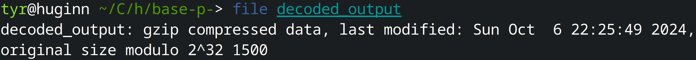

+++
title = "Base-p-"
description = "That looks like a weird encoding, I wonder what it's based on.\n\nDownload the file(s) below. "
authors = ["Tyr"]
date = 2024-09-30

categories = ["misc"]
+++

## Description

Base-p- 500 points - Miscellaneous - 9 Solves

Author: Izzy Spering

That looks like a weird encoding, I wonder what it's based on.

Download the file(s) below. 

----

First, let's take a look at the content of the `based.txt` file:
```=
楈繳籁萰杁癣怯蘲詶歴蝕絪敪ꕘ橃鹲𠁢腂𔕃饋𓁯𒁊鹓湵蝱硦楬驪腉繓鵃舱𒅡繃絎罅陰罌繖𔕱蝔浃虄眵虂𒄰𓉋詘襰ꅥ破ꌴ顂𔑫硳蕈訶𒀹饡鵄腦蔷樸𠁺襐浸椱欱蹌ꍣ鱙癅腏葧𔕇鱋鱸𓁮聊聍ꄸꈴ陉𔕁框ꅔ𔕩𔕃驂虪祑𓅁聨朸聣摸眲葮𖠳鵺穭𒁭豍摮饱恕𓉮詔葉鰸葭楷洳面𔕃𔑒踳𔐸杅𐙥湳橹驳陪楴氹橬𓄱蝔晏稸ꄸ防癓ꉁ𖡩鵱聲ꍆ稸鬶魚𓉯艭𔕬輷茳筋𔑭湰𓄲怸艈恧襺陷项譶ꍑ衮汮蹆杗筌蹙怰晘缸睰脹蹃鹬ꕓ脶湏赑魶繡罢𒉁荶腳ꌳ蕔𔐶橊欹𖥇繋赡𐙂饎罒鵡𒉮腙ꍮ楑恤魌虢昹𒅶效楙衎𔕙ꉨ𓈸𔑭樯筶筚絮𓁗浈豱ꉕ魔魧蕕聘筣鹖樫ꍖ汸湖萰腪轪𓉱艱絍笹艨魚詇腁𒁮陴顮虂癁
```

Well, I don't understand that much. Probably an encoding of some kind. But something about the name of the challenge caught my attention: **Base-p-**. This reminds me of the `-p-` parameter in **nmap**, which is used to specify the range of ports (from `1` to `65535`). This made me think it could be `base65536` encoding.

Let's try to decode it using an [online base65536 decoder](https://www.better-converter.com/Encoders-Decoders/Base65536-Decode):
```=
H4sIAG0OA2cA/+2QvUt6URjHj0XmC5ribzBLCwKdorJoSiu9qRfCl4jeILSICh1MapCINHEJpaLJVIqwTRC8DQ5BBQ0pKtXUpTej4C4lBckvsCHP6U9oadDhfL7P85zzPTx81416LYclYgEAOLgOGwKgxgnrJKMK8j4kIaAwF3TjiwCwBejQQDAshK82cKx/2BnO3xzhmEmoMWn/qdU+ntTUIO8gmOw438bbCwRv3Y8vE2ens9y5sejat497l51sTRO18E8j2aSAAkixqhrKFl8E6fZfotmMlw7Z3NKFmvp92s8+HMg+zTwaycvVQlnSn7FYW2LFYY0+X18JpB9LCYliSm6LO9QXvfaIbJAqvNsL3lTP6vJ596GyKIaXBnNdRJahnqYLnlQ4d+LfbQ91vpH0Y4NSYwhk8tmv/5vFZFnHWrH8qWUkTfgfUPXKcFVi+5Vlx7V90OjLjZqtqMMH9FhMZfGUALnotancBQAA
```

This output looks like base64 encoding. Let's decode it again, this time using a base64 decoder:
```bash
echo "H4sIAG0OA2cA/+2QvUt6URjHj0XmC5ribzBLCwKdorJoSiu9qRfCl4jeILSICh1MapCINHEJpaLJVIqwTRC8DQ5BBQ0pKtXUpTej4C4lBckvsCHP6U9oadDhfL7P85zzPTx81416LYclYgEAOLgOGwKgxgnrJKMK8j4kIaAwF3TjiwCwBejQQDAshK82cKx/2BnO3xzhmEmoMWn/qdU+ntTUIO8gmOw438bbCwRv3Y8vE2ens9y5sejat497l51sTRO18E8j2aSAAkixqhrKFl8E6fZfotmMlw7Z3NKFmvp92s8+HMg+zTwaycvVQlnSn7FYW2LFYY0+X18JpB9LCYliSm6LO9QXvfaIbJAqvNsL3lTP6vJ596GyKIaXBnNdRJahnqYLnlQ4d+LfbQ91vpH0Y4NSYwhk8tmv/5vFZFnHWrH8qWUkTfgfUPXKcFVi+5Vlx7V90OjLjZqtqMMH9FhMZfGUALnotancBQAA" | base64 -d > decoded_output
```
By inspecting the file type using the `file` command, we discover it is a compressed gzip file:
```bash
file decoded_output
```


Let's rename it with the `.gz` extension and decompress it:
```bash
mv decoded_output decoded_output.gz
gzip -d decoded_output.gz
file decoded_output
```
Now we have a PNG image file.


Adding the `.png`extension, and here is what it looks like:


By extracting the RGB values from each square (using an [online color picker](https://www.ginifab.com/feeds/pms/color_picker_from_image.php)), we obtain the following values:
```=
(102,108,97)
(103,123,53)
(56,54,99)
(102,56,99)
(56,52,57)
(99,57,55)
(51,48,101)
(97,55,98)
(50,49,49)
(50,102,102)
(102,51,57)
(102,102,54)
(97,125,32)
```

 Finally, we convert these decimal values to their corresponding ASCII characters (using a [decimal-to-ASCII decoder](https://www.coderstool.com/decimal-to-ascii)), and got the flag.

The flag is: `flag{586cf8c849c9730ea7b2112fff39ff6a}`